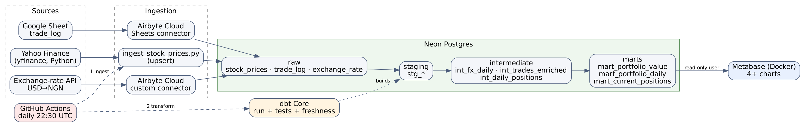
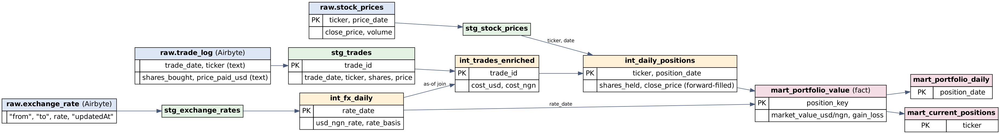

# PortfolioPulse

A daily-refreshed view of a personal stock portfolio in **USD and Nigerian Naira**.
Capstone project for the Datafrik data engineering programme.



**The question it answers:** what is my investment portfolio worth, in both USD and NGN, over time?

## How it works

1. **Ingest** (daily, GitHub Actions): daily closing prices from Yahoo Finance (Python), a trade log from a Google Sheet (Airbyte), and the USD to NGN exchange rate (custom Airbyte connector) are loaded into Neon Postgres as raw tables.
2. **Transform** (dbt Core): staging models clean each source, intermediate models join prices, trades and FX rates by day, and marts hold the final tables the dashboard reads. dbt tests run on every build.
3. **Verify**: a final check fails the run if the output is empty, stale, or missing the headline USD/NGN values.
4. **Visualise**: Metabase (Docker) reads the marts through a read-only database user.

## Stack
| Layer | Tool |
|---|---|
| Source 1: prices | `yfinance`, loaded by Python (upsert) |
| Source 2: trade log | Google Sheet, loaded by Airbyte Cloud |
| Source 3: USD to NGN rate | Custom Airbyte connector (`docs/airbyte_fx_connector.yaml`) |
| Warehouse | Neon Postgres |
| Transform | dbt Core (staging / intermediate / marts, plus tests) |
| BI | Metabase (Docker) |
| Orchestration | GitHub Actions, daily 22:30 UTC, also runnable by hand |

## Repo layout
```
ingestion/            yfinance loader, plus Python fallbacks for the two Airbyte sources
scripts/              airbyte_sync.py (trigger and wait), post_run_check.py, generate_trade_log.py
sql/                  raw schema contract, read-only role
portfolio_pulse_dbt/  models (staging, intermediate, marts), tests, macros
metabase/             docker-compose and the dashboard SQL
docs/                 diagrams and the Airbyte FX connector manifest
tests/                unit and local end-to-end tests (no internet needed)
.github/workflows/    portfolio_pipeline.yml (daily pipeline), bootstrap.yml (one-time setup)
```

## Data model


Marts: `mart_portfolio_value` (ticker x day fact), `mart_portfolio_daily` (portfolio totals, day change), `mart_current_positions` (latest holdings, allocation %).

## Setup
1. **Neon**: create a project, run `sql/01_raw_schema.sql`, then `sql/02_readonly_metabase_user.sql` (set a real password locally; never commit it).
2. **Airbyte Cloud**, with both connections on a **Manual** schedule (GitHub Actions triggers them through the API):
   - *Destination:* Postgres (Neon). Host, port 5432, database, user and password from Neon, SSL mode `require`, default schema `public`. Turn on **Drop tables with CASCADE**, because Airbyte replaces raw tables that dbt views depend on and `dbt run` recreates the views.
   - *Connection A, Google Sheet trade log:* source **Google Sheets** (OAuth), tab named `trade_log` with headers `trade_date, ticker, shares_bought, price_paid_usd`. Stream `trade_log`, sync mode **Full refresh | Overwrite**. Columns arrive as text and dbt cleans them in `stg_trades`.
   - *Connection B, USD to NGN rate:* in Airbyte **Builder**, choose **Import a YAML** and import `docs/airbyte_fx_connector.yaml` (it calls the free `open.er-api.com` API), publish it, and create a source from it. Stream `exchange_rate`, sync mode **Full refresh | Append**, so one rate per run accumulates and history builds up.
   - *API credentials:* click your name at the bottom of the left sidebar, then **User settings > Applications > Create an application**.
   - *IDs:* each connection's UUID is in its URL after `/connections/`.
3. **Trade log**: `python scripts/generate_trade_log.py` (needs internet) writes `data/trade_log.csv`; import it into the Sheet tab `trade_log`.
4. **GitHub secrets**: `NEON_HOST, NEON_DB, NEON_USER, NEON_PASSWORD, AIRBYTE_CLIENT_ID, AIRBYTE_CLIENT_SECRET, AIRBYTE_SHEETS_CONNECTION_ID, AIRBYTE_EXCHANGE_RATE_CONNECTION_ID` (plus `GOOGLE_SERVICE_ACCOUNT_JSON, TRADE_LOG_SHEET_ID` for the fallback). The repository variable `INGESTION_MODE` selects the path: `airbyte` uses Airbyte for the Sheet and the FX rate, and `python` uses the Python fallbacks, which write the same tables.
5. **First run**: Actions > *PortfolioPulse Daily Pipeline* > Run workflow. Use `backfill_from` (for example `2025-01-01`) only for the very first run, to load price history.
6. **Dashboard**: see Metabase below.

## Run the pipeline
The workflow `.github/workflows/portfolio_pipeline.yml` runs daily and can be started by hand. It has three jobs in order:
1. **Ingest all three sources**: Python prices, then the Airbyte syncs, waiting for each to finish.
2. **dbt**: source freshness, a raw-data quality gate, `dbt run`, `dbt test`, `dbt docs generate`.
3. **Post-run guard**: checks the output is fresh and sane, and writes the headline numbers to the run summary.

Any failing step turns the run red. Concurrent runs are blocked.

## Run locally
```bash
cp .env.example .env && set -a && source .env && set +a
pip install -r requirements.txt -r requirements-dbt.txt
python ingestion/ingest_stock_prices.py --backfill-from 2025-01-01
cd portfolio_pulse_dbt && dbt source freshness && dbt test --select source:raw && dbt run && dbt test
```

## Dashboard (Metabase)
1. `cd metabase && docker compose up -d`, then open http://localhost:3000 and create the admin account.
2. Add a PostgreSQL database: host, port 5432 and database from Neon, user **`portfolio_reader`** (the read-only role, not the owner), SSL on with mode `require`. If the connection times out, wake the Neon compute (run any query in Neon's SQL Editor) and retry.
3. Create the charts from `metabase/dashboard_queries.sql` (**New > SQL query**), save them to a collection, and add them to a dashboard: portfolio value over time (USD and NGN as two charts side by side), current allocation (donut), gain/loss by position (bar), and the USD/NGN rate.

## Testing
`pytest -q tests/` (unit and DB integration) and `python tests/local_e2e.py` (a full dbt build on synthetic data, compared with an independent pandas/Decimal calculation, plus loud-failure checks for bad tickers, dates and prices). The end-to-end test needs a local Postgres; see the script header. Offline only: `python -m pytest -q tests/test_unit.py`.

## Design decisions
The main choices are listed here and explained in more detail in [docs/design_decisions.md](docs/design_decisions.md).

| Decision | Why |
|---|---|
| Upsert for stock prices (`ON CONFLICT (ticker, price_date)`) | Re-running or backfilling is idempotent; Yahoo revises recent closes. |
| 3 retries then fail loudly; validate that every ticker returned data | A silent empty download must never look like success. |
| Airbyte writes raw text; dbt cleans it (`stg_trades`) | Sheets are human-edited ("$1,234.50", " aapl "). Cleaning in SQL is versioned and tested. |
| Raw quality gate (`dbt test --select source:raw`) before `dbt run` | Bad input stops the run before dashboards are rebuilt. |
| As-of join for FX with `rate_basis` (observed / carried_forward / backfilled) | Weekends and API gaps happen; the data shows when a rate was not observed instead of hiding it. |
| Window-function forward fill for prices (`is_stale_price` flag) | A missing close on one ticker must not drop the position. |
| Weekend trades valued from the next trading day | Avoids phantom positions and zero-price days. |
| Trade identity = content hash plus an occurrence counter | Two real identical buys on the same day both survive. |
| NGN cost basis uses the rate on the trade date; market value uses the daily rate | NGN gain/loss then includes the currency effect, which is the point of the NGN view. |
| One daily workflow, 3 jobs with `needs:` | Ingest, then transform, then verify; no dbt on stale data. A concurrency group prevents overlapping runs. |
| Airbyte connections on a Manual schedule, triggered by GitHub Actions | One orchestrator; an Airbyte schedule overlapping an API trigger returns HTTP 409. `scripts/airbyte_sync.py` waits for each job. |
| Sheet sync is Full refresh / Overwrite; FX sync is Full refresh / Append | The trade log is small and fully re-read each run; Append keeps one FX rate per run so NGN history accumulates. |
| Custom Airbyte FX connector on `open.er-api.com` | The earlier lecture API is now paid, and the brief allows no paid tools. |
| Read-only Postgres role for Metabase and for reviewers | Least privilege; credentials are never committed. |
| dbt Core, not dbt Cloud | Required by the brief. |

## Assumptions and limitations
- Buys only: no sells, dividends or splits. yfinance closes are split-adjusted while the prices in the trade log are not, so a stock split would distort a position.
- NGN history starts at the first FX sync; earlier dates use the earliest rate and are flagged `rate_basis = 'backfilled'`. The Airbyte FX `updatedAt` is the extraction time, not the provider's update time.
- Airbyte Cloud is on a 14-day trial; set `INGESTION_MODE=python` to use the Python fallbacks if it lapses.
- The trade log is generated by `scripts/generate_trade_log.py` using real historical closes, then imported into the Sheet.
- Metabase runs locally in Docker; the dashboard is stored in `metabase/data/` (not committed).
